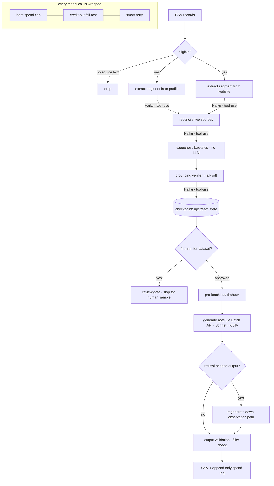

# LLM Enrichment Pipeline

A production-shaped pipeline for **structured record enrichment with LLMs**, built around the parts that are actually hard once you leave the demo: keeping output *grounded*, keeping spend *bounded*, and keeping a long batch run *recoverable*.

Given a CSV of records that each carry two messy text sources, it extracts a structured attribute (the market **segment** an entity serves), cross-checks it against the source to reject hallucinations, and generates a one-line analyst note, all under a hard dollar cap, with checkpoint/resume and a human review gate.

> **Provenance.** This is a de-identified distillation of a real pipeline I built and ran in production over ~11,000 records. Client data, domain specifics, and credentials are stripped; the architecture, guardrails, and the lessons baked into them are intact. It ships with synthetic data and an offline mock backend so you can run the whole thing in 30 seconds with no API key.

```
$ python -m enrichment --input examples/sample_records.csv \
      --output .runs/out.csv --max-cost 5 --dry-run --no-review-gate

[mode] DRY RUN: offline mock backend, no API key, no spend.
  eligibility: 12 eligible, 0 dropped (no usable source text)
  [checkpoint] wrote upstream state -> .runs/out__checkpoint_pre-generation.csv (12 rows)
  [healthcheck] ok: endpoint reachable, credits available
  submitting 12 requests to batch endpoint...
  progress: 12/12
  saved 12 rows -> .runs/out.csv

  [spend] total $0.0363 across 38 calls
========================================================
                status: OK
               records: 12
    recovered_refusals: 0
         flagged_notes: 0
        estimated_cost: 0.0363
========================================================
```

---

## Quick start

No API key needed: `--dry-run` swaps in a deterministic offline backend that emulates every model call.

```bash
git clone <this-repo> && cd llm-enrichment-pipeline
python -m pip install -r requirements.txt        # only pytest is needed for dry-run
PYTHONPATH=src python -m enrichment \
    --input examples/sample_records.csv \
    --output .runs/out.csv \
    --max-cost 5 --dry-run --no-review-gate
```

Run the tests:

```bash
PYTHONPATH=src python -m pytest -q     # 13 passing
```

Run it live (needs `ANTHROPIC_API_KEY`, see [`.env.example`](.env.example)):

```bash
PYTHONPATH=src python -m enrichment \
    --input your_records.csv --output out.csv --max-cost 20
```

---

## Architecture



Two model tiers: a cheap one (Haiku) does the four structured-extraction calls per record; a stronger one (Sonnet) does the single free-text generation, routed through the **Batch API for a 50% discount**. Every call (extraction, reconciliation, grounding, generation, even the healthcheck) flows through one guarded path (`spend.guarded_call`) so the budget, retry, and credit-out logic are identical everywhere and impossible to forget.

| Stage | Model | Purpose |
|---|---|---|
| Eligibility filter | none | Drop records with no usable source text (cost gate, not quality gate) |
| Extract ×2 | Haiku, tool-use | Pull the served segment from profile **and** website, independently |
| Reconcile | Haiku, tool-use | Fuse the two; disagreement → lower confidence |
| Vagueness backstop | none | Deterministically downgrade generic non-answers ("serves businesses") |
| Grounding verify | Haiku, tool-use | Reject claims not supported by the source (fail-soft) |
| Checkpoint | none | Persist upstream state before the expensive batch |
| Review gate | none | Block the first run per dataset for a human sample check |
| Generate | Sonnet, **Batch** | Write the one-line note, routed by final confidence |
| Refusal recovery | Sonnet | Catch meta-prose refusals; regenerate the simple way |
| Output validation | none | Flag banned filler before it ships |

---

## The decisions that matter

The interesting part isn't "call an LLM on each row." It's the seven decisions below, and each one is a scar from a real failure. Longer writeup in [`docs/design-decisions.md`](docs/design-decisions.md).

**1. Tool-use, not "respond only with JSON."** Every extraction is a *forced* tool call with an explicit `input_schema`. The prose-JSON approach it replaced produced a low-but-nonzero rate of unparseable output (truncation, stray preamble, and the nasty one: a list where a string was promised, which crashed `.strip()` three stages downstream and shipped as a silent blank). Schema enforcement deleted that whole failure class. ([`extract.py`](src/enrichment/extract.py))

**2. Two sources, then reconcile.** A single source lies confidently. Extracting from profile and website *independently* and reconciling turns a guess into a cross-checked claim, and the disagreement signal itself becomes the confidence score (two confident-but-different sources → `medium`, never `high`).

**3. A grounding verifier that fails soft.** A separate, strict pass asks "is this segment actually supported by the source text?" If a `high`-confidence claim isn't grounded, it drops one notch rather than being discarded. A *flaky verifier* fails open, because a broken check should never delete good data. Hallucination control without throwing the baby out.

**4. Refusal recovery.** When a record's two sources look like different entities, the model sometimes refuses and writes *prose explaining why it can't*. A "non-empty output" check passes that straight through, and it would ship as the result. `is_refusal()` detects the shape (refusal phrasing, or simply too long to be a one-liner) and regenerates down the simpler observation-only path. ([`generate.py`](src/enrichment/generate.py))

**5. A hard spend cap, enforced mid-run.** `--max-cost` is *required*: there's no way to start a run without declaring a ceiling. A running estimate is checked after every call; the instant it crosses the cap, the run aborts with exit code 2. ([`spend.py`](src/enrichment/spend.py))

**6. Credit-out fail-fast + a pre-batch healthcheck.** Out-of-credit is permanent, so it's *never* retried. Because the Batch endpoint sometimes wraps it in a 5xx, classification sniffs the message body, not just the status code. Before submitting N expensive batch requests, a single trivial request confirms credits + endpoint health for ~$0.0001. This pair exists because the un-guarded version once retried a credit-out through a whole batch window and burned both the budget and hours of upstream work.

**7. Checkpoint/resume + a first-run review gate.** Upstream extraction (4 calls/record) is written to disk *before* batch submission, so a crash becomes a cheap `--resume-checkpoint` restart instead of a full re-run. And the first run on any dataset stops to dump a 30-row sample for a human to eyeball, because "the run completed" tells you nothing about whether the output is any good. ([`checkpoint.py`](src/enrichment/checkpoint.py), [`review_gate.py`](src/enrichment/review_gate.py))

---

## Cost model

Estimates are a deliberate *upper bound*: you want the cap to trip before real money moves, not after reconciling an invoice. The dry-run uses the same estimator, so it doubles as a free cost projection for a dataset.

| Call | Model | ~Cost / record |
|---|---|--:|
| Profile extract | Haiku | $0.0009 |
| Website extract | Haiku | $0.0025 |
| Reconcile | Haiku | $0.0010 |
| Grounding verify | Haiku | $0.0012 |
| Note (Sonnet, Batch −50%) | Sonnet | $0.0017 |
| **Total** | | **~$0.0073** |

The single biggest cost lever was *input size*: the extraction stages only need a representative slice of the website text, and the grounding verifier needs even less. Capping those (`Limits` in [`config.py`](src/enrichment/config.py)) cut per-record cost ~3×.

---

## Project layout

```
src/enrichment/
  __main__.py     CLI: flags, mode selection, exit codes
  pipeline.py     orchestration: wiring + how confidence flows between stages
  backends.py     Backend interface + real (Anthropic) and mock (offline) impls
  spend.py        SpendTracker, the hard cap, and the one guarded_call path
  extract.py      4 tool schemas + extract / reconcile / vagueness / grounding
  generate.py     batch build + healthcheck + poll, refusal recovery, validation
  checkpoint.py   persist/resume upstream state around the batch boundary
  review_gate.py  first-run human sample gate
  errors.py       backend-agnostic error taxonomy (credit-out / permanent / transient)
  config.py       models, pricing, tunable limits, run settings
examples/         synthetic sample dataset
tests/            13 tests over the guardrails + an end-to-end dry run
docs/             architecture + design-decisions writeups
```

## Design notes

- **Vendor-agnostic core.** The pipeline talks to a small `Backend` protocol, never the SDK. Exceptions are mapped onto a three-class taxonomy (`credit-out` / `permanent` / `transient`) at the boundary, which is what keeps the retry policy identical across the real and mock backends. It also makes the whole thing trivially testable offline.
- **Website fetching is out of scope** here: records arrive with `website_text` already populated. In production that was a concurrent fetch stage; it's omitted so this repo carries no scraper and no network assumptions.

## License

MIT. See [LICENSE](LICENSE).
